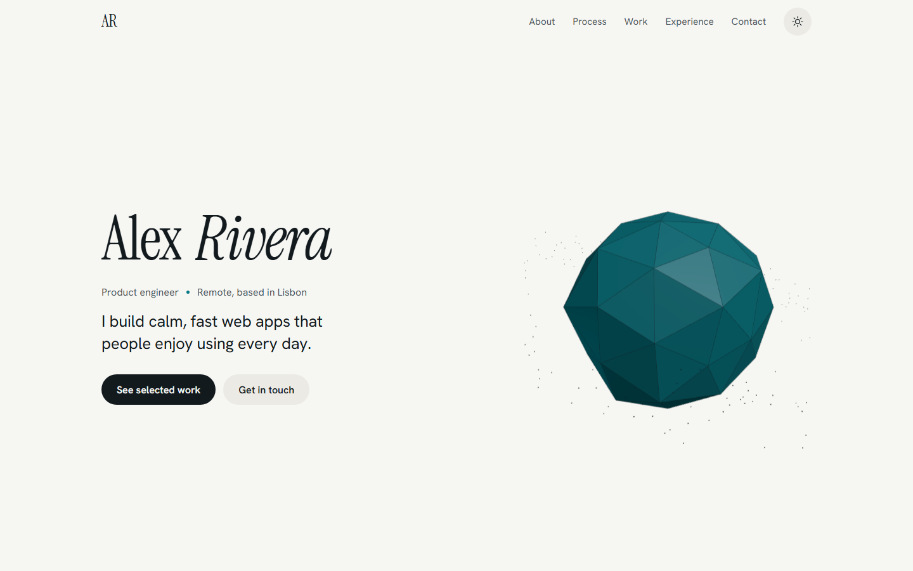
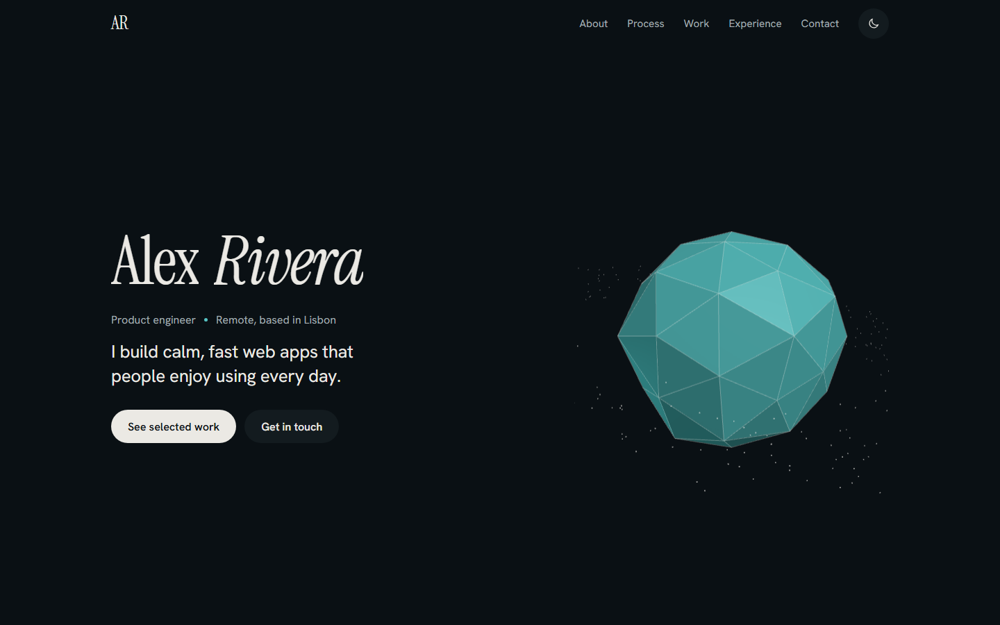
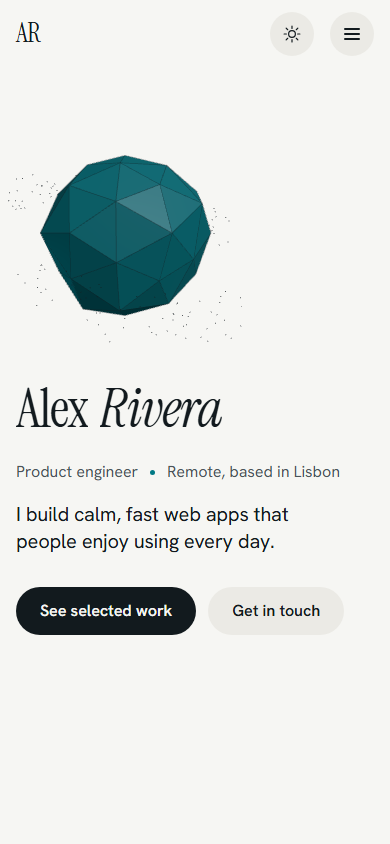
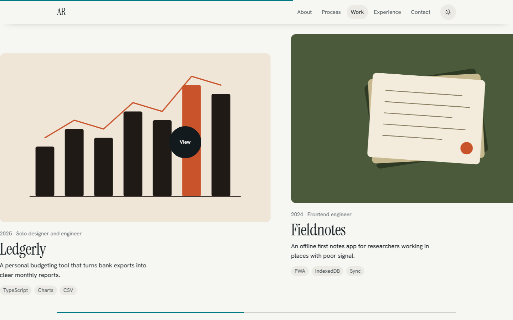
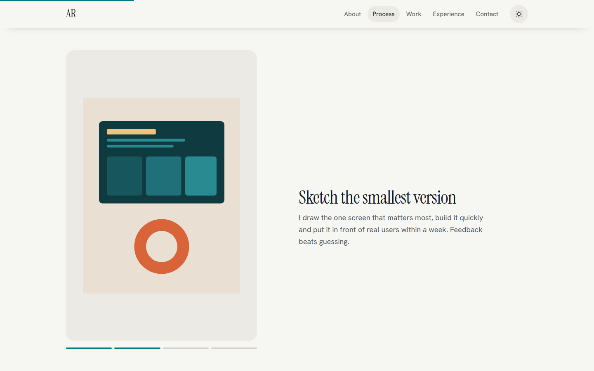
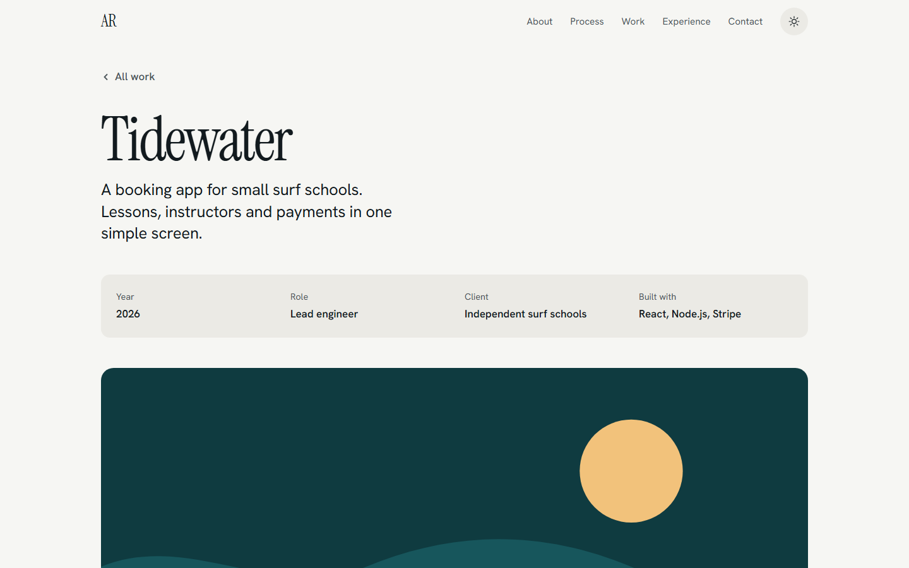

# Leo's starter: Portfolio

A studio-style personal portfolio: a 3D hero, a pinned "how I work" story, a horizontal work
strip that moves as you scroll, a gallery that reveals itself, and a page for every project.
Plain HTML, CSS and JavaScript. No build step, no framework, no animation library, no trackers.
Part of Leo's starters from [Replore](https://replore.cardzo.co.in), a Cardzo product.



| Dark theme | Phone |
| --- | --- |
|  |  |

| Horizontal work strip | Pinned story | Project page |
| --- | --- | --- |
|  |  |  |

## What you get

- **Hero** with your name, role and two buttons, next to a slowly turning low-poly stone drawn
  with three.js. It tilts toward the pointer and turns as you scroll.
- **Pinned story ("How I work")**: the picture stays in place while your chapters scroll past,
  and swaps as each chapter reaches the middle of the screen. A progress bar shows where you are.
- **Selected work, scrolling sideways**: on wide screens the section pins and your vertical
  scroll moves the strip of projects sideways. It uses CSS scroll-driven animations where the
  browser supports them, and a tiny scroll handler elsewhere. Native scrolling is never taken
  over. Tabbing to a card scrolls it into view. On phones it is a swipeable row; with reduced
  motion it is a calm two-column grid.
- **A page for every project** at `#/work/<slug>`: title, facts, story, results, a gallery and
  a link to the next project. Where the browser has the View Transitions API, the card image
  grows into the project page; elsewhere the view simply swaps. Back returns you to the strip
  where you left it.
- **Gallery** ("Studio notes") whose images open from an inset frame as they scroll into view.
- **Custom cursor** on mouse and trackpad devices only: a ring that trails the pointer, grows
  over links and shows "View" over projects. The normal cursor stays, so nothing depends on it.
- **Experience timeline** whose line fills as you read, and a contact section with a
  `mailto:` link and a "Copy email address" button. No backend, no form service.
- Light and dark themes that follow the visitor's system setting until they pick one.
- **Reduced motion respected**: no travel, no 3D (a static drawing instead), no custom cursor,
  colour and opacity changes only.
- No layout shift: images carry their sizes, reveals change only opacity, transform and
  clip-path, and the 3D stone swaps in over a drawing of the same size.
- Self-hosted fonts (Instrument Serif and Hanken Grotesk). No requests to other sites.
- **All words, links and projects live in one file: `content.js`.**

## Quick start

1. **Edit `content.js`.** Change the name, role, email, story chapters, projects and gallery.
   Replace the images in `assets/` (keep the same file names, or update the paths).
2. **Open it.** Double-click `index.html` to preview. For the full 3D hero, serve the folder,
   because browsers only load JavaScript modules (three.js) over http:

   ```
   python -m http.server 8000
   ```

   Then open http://localhost:8000. Opened straight from disk, the page shows a static drawing of
   the stone instead of the 3D one. Everything else works the same.
3. **Deploy it.** Pick one:

   **GitHub Pages**
   1. Create an empty repository on GitHub, for example `portfolio`.
   2. In this folder run:
      ```
      git remote add origin https://github.com/YOUR-NAME/portfolio.git
      git push -u origin main
      ```
   3. On GitHub open **Settings > Pages**. Under **Build and deployment** choose
      **Source: Deploy from a branch**, then **Branch: main** and **/ (root)**, and click **Save**.
   4. After a minute your site is live at `https://YOUR-NAME.github.io/portfolio/`.

   **Cloudflare Pages**
   1. In the Cloudflare dashboard open **Workers & Pages > Create > Pages**.
   2. Choose **Upload assets**, give the project a name and click **Create project**.
   3. Drag this whole folder onto the upload box and click **Deploy site**.
   4. Or choose **Connect to Git** instead, pick your repository, set **Framework preset: None**,
      leave **Build command** empty and set **Build output directory** to `/`.

   **Netlify**
   1. Go to https://app.netlify.com/drop and drag this folder onto the page. That is it.
   2. Or in Netlify choose **Add new site > Import an existing project**, pick your repository,
      leave **Build command** empty and set **Publish directory** to `.`.

## Customising

- **Colours:** edit the tokens at the top of `styles.css` (`--bg`, `--ink`, `--accent` and
  friends). There is one block for light and one for dark. The 3D stone reads `--accent` and
  `--ink`, so it follows your palette.
- **Fonts:** `fonts/fonts.css` holds the fonts as base64 so they work even from disk. To use other
  fonts, replace its `@font-face` rules and update `--font-display` and `--font-body`.
- **Projects:** add or remove objects in `projects.items` in `content.js`. Each needs a `slug`
  (lowercase, dashes) for its page. `story`, `results` and `gallery` are optional; leave `live`
  or `code` empty (`""`) to hide that link. A project without an image leads with its title.
- **Story and gallery:** edit `story.chapters` and `gallery.items`. Remove all items to hide
  the section.
- **Motion:** the hero intro and the timeline fill are in `motion.js` (the Web Animations API
  and CSS scroll-driven animations). The work strip, story, reveals, cursor and project pages
  are in `main.js` and `styles.css`. Easing tokens (`--ease-out`, `--ease-in-out`) live at the
  top of `styles.css`.
- **3D hero:** `hero3d.js`. Change the shape (`IcosahedronGeometry`), the number of orbit points
  or the speed. Delete the `loadHero3d` call in `main.js` to keep only the static drawing.
- **Sections:** each section is a plain `<section>` in `index.html`. Remove one by deleting it
  and its link in the header.

## Safe AI coding with Governor

This template comes with [Governor](https://github.com/chittychat-studio/Governance-manager)
pre-installed: a safety kit for AI coding agents in Claude Code (and advisory rules for Codex).

**What it does.** When you open this folder in Claude Code, Governor's rules stop the agent from
reading secret files such as `.env`, wiping folders with `rm -rf` or `Remove-Item -Recurse
-Force`, force-pushing, piping downloaded scripts into a shell, or switching its own safety off.
It asks you before production deploys, package installs, web fetches and commands that call paid
AI services, and it scans every file the agent writes for API keys. This template is set to
tier 3, the strictest, because a portfolio is public and shows a personal email address. Every
rule is listed, as enforced or advisory, in `.claude/governor/COVERAGE.md`.

**What was added:** `governance.yaml` (the answers and the tier), `.claude/settings.json`,
`.claude/hooks/` (small Python scripts, standard library only), `.claude/rules/governor.md` and a
marked block in `CLAUDE.md` and `AGENTS.md`. The website never loads any of it. The hooks need
Python 3.11 or newer. After cloning, restart Claude Code once so the hooks load.

**Refresh it** when your project changes (logins, a database, payments, tests): install the
plugin with `/plugin marketplace add chittychat-studio/Governance-manager` and
`/plugin install governor@chittychat-governor`, then run `/governor:init` in this folder.
`/governor:status` shows what is blocked and what needs your OK.

**Remove it:** run `/governor:remove`. It shows what would be removed and prints a command for you
to run yourself in a terminal outside Claude Code (the agent is not allowed to remove its own
guardrails). Without the plugin, delete `governance.yaml`, the `.claude/` folder and the
`<!-- governor:start -->` to `<!-- governor:end -->` blocks in `CLAUDE.md` and `AGENTS.md`.

## Credits

- Built by Cardzo for Replore. Code: MIT licence, see `LICENSE`.
- [three.js](https://threejs.org) (MIT) for the 3D hero. All other motion uses browser features
  only: the Web Animations API, CSS scroll-driven animations, View Transitions and
  IntersectionObserver.
- [Governor](https://github.com/chittychat-studio/Governance-manager) (MIT) for AI coding
  guardrails.
- Fonts: Instrument Serif and Hanken Grotesk, SIL Open Font License.
- Design and motion guidance (no code copied): Impeccable, Emil Kowalski's design engineering
  skills and taste-skill. See `NOTICE.md`.

Full licence details, versions and sources are in `NOTICE.md`.
